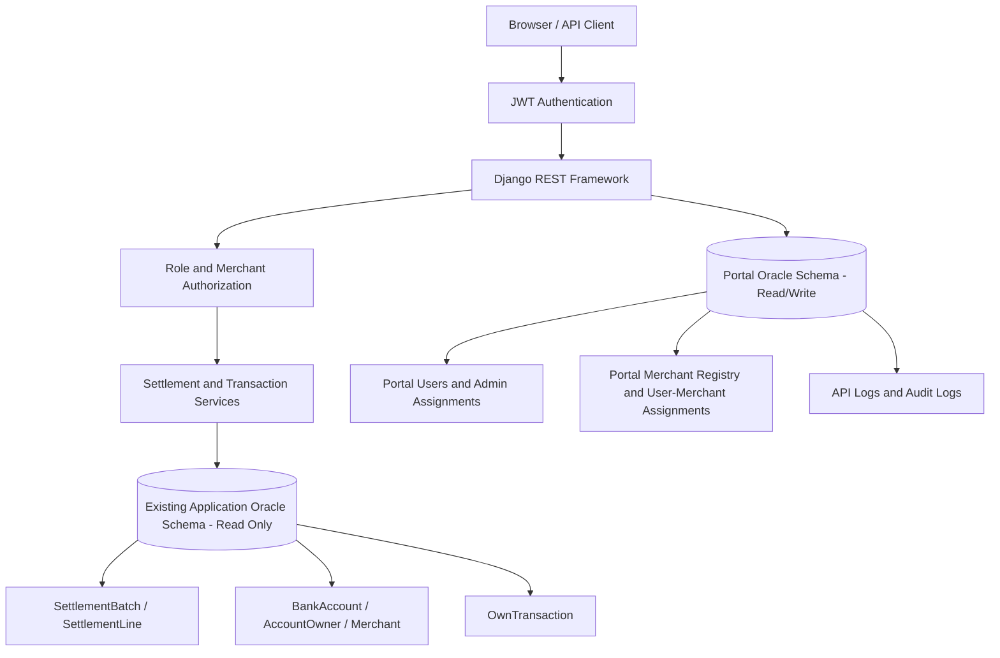

# Merchant Settlement API Portal — Implementation Plan

## 1. Purpose

Build a new, standalone API portal for merchants to retrieve settlement summaries and transaction details. The portal will be developed with **Django REST Framework (DRF)**, use **Oracle Database 19c**, authenticate API requests with **JWT access tokens valid for two hours**, and run in a **separate Docker Compose project**.

The existing settlement application (`apps/settlement`, `apps/ingestion`, `apps/bank_accounts`, `apps/merchants`, etc. in this repo) remains the source of truth for `SettlementBatch`, `SettlementLine`, `BankAccount`, `AccountOwner`/`Merchant`/`Vendor`/`Processor`, and `OwnTransaction`. The new portal will store its own users, merchant registry, user-to-merchant assignments, API request history, and administrative audit history in a separate Oracle schema.

The portal must **not** modify the existing application's source tables. It must be a separate Django project (e.g., `merchant-settlement-portal/`) — do **not** add these features under `apps/` of this reconciliation application. Both projects may live in the same monorepo, but they must be independently deployable with their own `manage.py`, settings, dependencies, and a separate Docker Compose project (e.g., `docker-compose.portal.yml`).

## 2. Confirmed requirements

- Build a separate Django REST Framework application; do not add these features to the existing application.
- Use Oracle Database 19c.
- Use a separate Oracle schema for the portal's writable application data.
- Use a read-only database account for the required tables in the existing application schema.
- Use Docker with a separate Docker Compose file/project for the portal.
- Public user registration is disabled. Superadmins and admins create or manage accounts.
- Roles are `SUPERADMIN`, `ADMIN`, and `USER`.
- JWT access tokens expire after **2 hours**.
- Users can log in, manage their profile/password, read API documentation, obtain/use API credentials or tokens, and view their own API call history.
- Superadmins can manage admins and all users. Admins can manage only users they created or users explicitly assigned to them.
- Superadmins and admins can add merchants, assign merchants to users, and review API logs within their permitted scope.
- A user can be assigned multiple merchants. A merchant can be assigned to multiple users.
- The portal has its own merchant registry containing a unique merchant UID and unique merchant name.
- Merchant names are unique, so `OwnTransaction.merchant_name` can be matched to the portal merchant registry.
- For settlement lines, resolve merchant ownership through `SettlementLine.cr_account` → `BankAccount.owner`.
- Settlement reporting filters individual lines by related batch `date_from`; each result includes the full batch period as `transaction_period`.
- Batch status does not filter settlement lines. `SettlementLine.status == 'APPROVED'` maps to `SUCCESS`; all other values map to `PENDING`.
- `paid_amount` is the line amount when approved and `0.00` otherwise; `payment_date` comes from `SettlementLine.approved_at`.
- Settlement report requests may span at most 60 calendar dates, inclusive. The transaction endpoint remains paginated and is not subject to this report date cap.
- USER accounts have multi-merchant report access disabled by default; an admin or superadmin must enable it. Merchant assignment checks still apply to every requested merchant.
- The transaction endpoint returns `OwnTransaction.merchant_amount`, not the transaction's gross `amount`.
- The transaction endpoint returns transactions assigned to settlement batches.
- Transaction results are paginated, with a maximum of 200 records per page.

## 3. Technology stack

| Concern | Choice |
|---|---|
| Language | Python |
| Web framework | Django |
| REST APIs | Django REST Framework |
| Authentication | JWT via `djangorestframework-simplejwt` (access token lifetime = 120 minutes) |
| API docs | OpenAPI/Swagger via `drf-spectacular` (protected by portal auth as appropriate) |
| Database | Oracle Database 19c |
| Database access | One Oracle connection using the portal account with source-object read-only grants |
| Deployment | Docker and a separate Docker Compose project (separate from existing `docker-compose.yml`) |
| Testing | Django/DRF tests, Oracle integration tests, authorization tests |

Portal dependencies (suggested): `Django`, `djangorestframework`, `djangorestframework-simplejwt`, `drf-spectacular`, `oracledb`, `django-environ`, `gunicorn`, `whitenoise`, etc. (mirror needs of this repo where relevant).

Django is recommended over introducing a second framework because the portal needs user management, admin screens, forms, permissions, database models, and a simple authenticated web interface in addition to APIs.

## 4. High-level architecture



### Database separation

Configure the two database connections separately, even if both schemas are hosted on the same Oracle 19c instance:

1. **Portal database connection** (e.g., `default` or `portal`) — owns portal tables and has the necessary read/write privileges on those tables.
2. **Source database connection** (e.g., `source`) — may read only the explicitly approved source tables in the existing application's schema. It must not have insert, update, delete, or DDL privileges on those tables.

Use `managed = False` for Django models that map to existing source tables (`SettlementBatch`, `SettlementLine`, `BankAccount`, `AccountOwner` (and its subclasses `Merchant`/`Vendor`/`Processor` as needed), `OwnTransaction`, and `django_content_type`). Migrations must create or modify only portal-owned tables. Use an explicit database router (and/or repository/service layer) to prevent writes to source models (route source models to `source` and block writes; route portal models to portal DB).

The exact Oracle object names and grants must be verified against this repo's migrations/model definitions before deployment. Resolving `BankAccount.owner` through a `GenericForeignKey` requires read access to `django_content_type` (and the target owner tables like `merchants`, `vendors`, `processors`, `account_owners` as applicable). Only owners that are `Merchant` instances should be included in merchant settlement reports.

## 5. Portal database design

All tables in this section are created in the new portal schema. Names are proposed names and may be adjusted to the project's naming conventions.

### 5.1 `PORTAL_USER`

Use a custom Django user model, preferably based on `AbstractUser`, with an explicit role field.

Suggested fields:

- `id` — primary key.
- `username` — unique login name.
- `email` — optional or required according to the final account policy.
- `password` — Django password hash only; never store plaintext passwords.
- `role` — `SUPERADMIN`, `ADMIN`, or `USER`.
- `is_active` — whether login and API access are allowed.
- `created_by_id` — user who created this account; nullable for the initial superadmin/system bootstrap account.
- `date_joined`, `last_login`, `created_at`, `updated_at`.

The `created_by` relationship is used to determine which users an ADMIN is allowed to manage. The initial superadmin should be created through a controlled deployment/bootstrap process, not public registration.

### 5.2 `PORTAL_ADMIN_USER_ASSIGNMENT`

Records users explicitly assigned to an ADMIN, including users not originally created by that ADMIN.

Suggested fields:

- `id` — primary key.
- `admin_id` — foreign key to `PORTAL_USER`, constrained to role `ADMIN` by application validation.
- `user_id` — foreign key to `PORTAL_USER`, constrained to role `USER` by application validation.
- `assigned_by_id` — user who made the assignment.
- `assigned_at` — timestamp.
- Unique constraint on (`admin_id`, `user_id`).

An ADMIN's manageable users are the union of:

1. `USER` accounts where `created_by_id` is that ADMIN; and
2. `USER` accounts explicitly assigned to that ADMIN in `PORTAL_ADMIN_USER_ASSIGNMENT`.

A SUPERADMIN can manage all users and establish or remove admin assignments. An ADMIN must not be able to assign themselves arbitrary users outside their authorized scope or promote users to administrative roles.

### 5.3 `PORTAL_MERCHANT`

This is the portal's local merchant registry. It connects the public `merchant_uid` used by API clients to the merchant name found in source records.

Suggested fields:

- `id` — internal primary key.
- `merchant_uid` — unique, stable public merchant identifier.
- `merchant_name` — unique human-readable merchant name.
- `merchant_name_key` — normalized matching key (trimmed and case-normalized) with a unique constraint to prevent case/whitespace variants from creating ambiguous matches.
- `is_active` — controls new assignments and API access.
- `created_by_id` — user who added the merchant.
- `created_at`, `updated_at`.

The `merchant_uid` should be generated or entered under a documented policy and must not be silently changed after clients start using it. Merchant matching should use the normalized name key while preserving the original display name.

### 5.4 `PORTAL_USER_MERCHANT`

Implements the many-to-many relationship between portal users and merchants.

Suggested fields:

- `id` — primary key.
- `user_id` — foreign key to `PORTAL_USER`.
- `merchant_id` — foreign key to `PORTAL_MERCHANT`.
- `assigned_by_id` — administrator who made the assignment.
- `assigned_at` — timestamp.
- Unique constraint on (`user_id`, `merchant_id`).

Only authorized administrators can add or remove assignments. An API USER can access settlement data only for active merchants assigned to that user. Submitted merchant UIDs must never be treated as authorization by themselves.

### 5.5 `PORTAL_API_LOG`

Stores API call history for monitoring and troubleshooting.

Suggested fields:

- `id` — primary key.
- `user_id` — authenticated user, nullable only for requests that cannot be associated with an authenticated account.
- `request_id` — unique correlation/request identifier.
- `endpoint`, `http_method`, `http_status`.
- `started_at`, `duration_ms`.
- `merchant_uid` — optional merchant context where applicable.
- `page_number`, `result_count` — optional endpoint metadata.
- `client_ip` — only if permitted by the organization's security/privacy policy.
- `error_code` — sanitized error identifier, if applicable.

Do not store passwords, JWTs, refresh tokens, authorization headers, or full sensitive response bodies. Avoid storing full financial request/response payloads unless there is an approved business requirement. Define a retention period and a cleanup process before production.

### 5.6 `PORTAL_AUDIT_LOG`

Records administrative and security-sensitive actions.

Examples include:

- Creating, deactivating, or reactivating a user.
- Creating or changing an ADMIN-to-USER assignment.
- Adding/deactivating a merchant.
- Assigning or removing a merchant from a user.
- Password-reset initiation and credential/token revocation events, without recording secrets.
- Changes to roles or permissions.

Suggested fields include `actor_user_id`, `action`, `target_type`, `target_id`, `created_at`, `request_id`, and a sanitized metadata field. Audit records should be append-only to normal portal roles.

## 6. Source data and merchant resolution

### 6.1 Settlement-line merchant lookup

Use the following relationship from the existing application:

```text
SettlementLine.cr_account_id
    -> BankAccount.id
    -> BankAccount.owner_type / BankAccount.owner_id
    -> BankAccount.owner (GenericForeignKey)
    -> merchant owner/name
    -> PORTAL_MERCHANT.merchant_name_key
    -> PORTAL_MERCHANT.merchant_uid
```

Resolve the generic owner using both the content type and owner ID. Only accounts whose owner is a Merchant should be included in merchant settlement reports; do not accidentally classify Vendor or Processor owners as merchants. Verify the actual `Merchant` model/table and content-type rows in the source schema during implementation.

Multiple settlement lines can resolve to the same merchant within the same batch. Aggregate them at **merchant + settlement batch** level before constructing the response.

### 6.2 Transaction merchant lookup

Use `OwnTransaction.merchant_name` to look up `PORTAL_MERCHANT` through the normalized unique merchant name. Return the portal's `merchant_uid` and registered merchant name in the API response.

The transaction endpoint must require `OwnTransaction.settlement_batch` to be non-null and must restrict results to the agreed eligible settlement-batch statuses. A merchant-name match alone is not enough; the transaction must also be assigned to an eligible batch.

### 6.3 Source tables and read grants

The exact table list must be verified against deployed model metadata and migrations in this repo. Based on the models above, the read-only source account will likely need `SELECT` access to the objects backing:

- `SettlementBatch` → `SETTLEMENT_BATCH` (`apps.settlement.models.SettlementBatch`)
- `SettlementLine` → `SETTLEMENT_LINE` (`apps.settlement.models.SettlementLine`)
- `BankAccount` → `bank_accounts` (`apps.bank_accounts.models.BankAccount`)
- `AccountOwner` → `account_owners` (`apps.bank_accounts.models.AccountOwner`)
- `Merchant` → `merchants` (`apps.merchants.models.Merchant`)
- `Vendor` → `vendors` (if needed for owner resolution context) and `Processor` → `processors` (if needed)
- `OwnTransaction` → `INGESTION_OWN_TRANSACTION` (`apps.ingestion.models.OwnTransaction`)
- Django content-type metadata → `django_content_type` (needed to resolve `BankAccount.owner` GenericForeignKey)

Grant access only to the required objects. Do not grant broad source-schema write privileges. Add synonyms or configure schema-qualified table names if required by the Oracle/Django setup. Use `managed = False` and ensure queries go through the read-only `source` database connection.

## 7. Roles and authorization

| Capability | SUPERADMIN | ADMIN | USER |
|---|---:|---:|---:|
| View global dashboard | Yes | No | No |
| View own administration dashboard | Yes | Yes | No |
| Create/manage ADMIN accounts | Yes | No | No |
| Create/manage USER accounts | All users | Created or explicitly assigned users only | No |
| Assign a USER to an ADMIN | Yes | Only within permitted scope; cannot grant cross-admin access | No |
| Add/deactivate merchants | Yes | Yes | No |
| Assign merchants to users | Yes | Yes, for users in their scope | No |
| View API logs | All logs | Logs for users in their scope and their own calls | Own calls only |
| View audit logs | All | Actions within their permitted scope | No, except relevant own security history if desired |
| View API documentation | Yes | Yes | Yes |
| Use settlement APIs | Configurable; global scope only if explicitly enabled | Configurable; only within authorized merchant scope if enabled | Yes, assigned active merchants only |
| Change own profile/password | Yes | Yes | Yes |

**Important authorization rule:** An ADMIN's scope is the union of users they created and users explicitly assigned to them. The same scope must be applied to every dashboard query, detail page, log query, user-management action, and merchant-assignment action. Hiding a button in the UI is not sufficient; every server-side endpoint must enforce the rule.

By default, public registration is disabled. Role changes, administrative assignments, and superadmin creation must be restricted to authorized operations. A user cannot grant themselves roles, merchant access, or user-management privileges through request data.

## 8. Portal pages

### 8.1 Common pages

- Login/logout.
- Profile page.
- Change-password page.
- API documentation (OpenAPI/Swagger UI).
- API authentication/token instructions.
- Personal API call history.
- Account/session status and helpful API error descriptions.

### 8.2 USER portal

- Show assigned active merchants and their UIDs.
- Show API documentation and request examples.
- Explain how to obtain/use JWT access tokens.
- List the user's own API call history, statuses, timestamps, duration, and request IDs.
- Provide profile and password management.
- Do not provide merchant assignment or user-administration controls.

### 8.3 ADMIN dashboard

- Summary of managed users and their active/inactive state.
- Create/deactivate users and reset credentials where authorized.
- View user details only for created or explicitly assigned users.
- Add/deactivate merchants.
- Assign/unassign merchants to users within the admin's scope.
- Review API logs for managed users and inspect failure trends.
- Review audit events within the admin's scope.

### 8.4 SUPERADMIN dashboard

- Global summary and access to all admin/user accounts.
- Create, deactivate, and manage ADMIN accounts.
- Manage all USER accounts and admin-user assignments.
- Add/deactivate merchants and manage all user-merchant assignments.
- View all API logs and administrative audit history.
- Retain access to recovery and system administration operations.

Public registration remains unavailable.

## 9. API authentication and authorization

- Use JWT authentication, preferably the Simple JWT package for Django REST Framework.
- Set the access-token lifetime to exactly **2 hours** (120 minutes).
- Do not place tokens or secrets in application logs.
- Use a strong, environment-supplied JWT signing secret and rotate it under an operational policy.
- Configure refresh-token lifetime, rotation, and blacklist/revocation separately from the two-hour access-token lifetime. The access-token lifetime is the confirmed requirement; the refresh-token policy should be set in deployment configuration.
- Enforce active-user checks and merchant assignments on every protected request.
- Use HTTPS in production.
- Add rate limits/throttling appropriate to user-based API access.
- Ensure disabled users cannot obtain new tokens. If immediate revocation of already-issued access tokens is required, implement a token-version/revocation strategy because a stateless JWT may otherwise remain valid until expiry.

## 10. API endpoints

All business and authentication endpoint paths are versioned under `/api/v1/`. Dates in request/response examples use `dd-mm-yyyy`, per the existing specification. Validate that `from_date` is not later than `to_date`.

### 10.1 Multi-merchant settlement report

**Endpoint**

```http
POST /api/v1/settlement-report
Authorization: Bearer <access_token>
Content-Type: application/json
```

**Request**

```json
{
  "from_date": "01-10-2026",
  "to_date": "18-10-2026",
  "merchants": ["merchantUID-001", "merchantUID-002"]
}
```

**Rules**

1. Authenticate the caller.
2. Validate date format and date order.
3. Validate that every requested merchant UID exists, is active, and is assigned to the caller (for a USER role).
4. Query settlement lines whose related batch `date_from` is within the requested date range, without filtering by batch status.
5. Resolve each settlement line's merchant via its credit account owner.
6. Return one result per matching line, with `transaction_period` formatted from the related batch dates and `payment_date` from the line's `approved_at`.
7. Calculate `total_amount`, `paid_amount`, and status using Section 11.

**Illustrative response**

```json
{
  "success": true,
  "data": [
    {
      "merchant_uid": "merchantUID-001",
      "merchant_name": "Example Merchant Ltd.",
      "settlements": [
        {
          "transaction_period": "01-10-2026 - 07-10-2026",
          "payment_date": null,
          "total_amount": "10000.00",
          "paid_amount": "10000.00",
          "status": "SUCCESS"
        }
      ]
    }
  ]
}
```

The requested date range filters lines by the related batch's `date_from` (inclusive); `transaction_period` describes the related batch's full business period. `payment_date` is the line's approval date, or `null` if it has not been approved. Monetary values should be serialized as decimal strings with two decimal places.

### 10.2 Single-merchant settlement report

**Endpoint**

```http
POST /api/v1/settlement-report/{merchantUID}
Authorization: Bearer <access_token>
Content-Type: application/json
```

**Request**

```json
{
  "from_date": "01-10-2026",
  "to_date": "18-10-2026"
}
```

The result has the same response structure as the multi-merchant report, but contains only the specified merchant. The service must authorize the merchant UID before returning data.

### 10.3 Merchant settlement transactions

**Endpoint**

```http
POST /api/v1/settlement-transactions/{merchantUID}?page=1
Authorization: Bearer <access_token>
Content-Type: application/json
```

**Request**

```json
{
  "from_date": "01-10-2026",
  "to_date": "18-10-2026"
}
```

**Rules**

- Return source transactions for the specified merchant matched by `OwnTransaction.merchant_name`.
- Require a non-null settlement-batch assignment.
- Restrict results to transactions assigned to eligible batches (`PARTIAL` or `COMPLETED` by default).
- Return `merchant_amount` as the API amount, not `OwnTransaction.amount`.
- Paginate with a maximum page size of 200. Validate `page` as a positive integer and define a deterministic ordering, preferably `txn_datetime` plus the transaction primary key as a tie-breaker.
- USER accounts can call this endpoint only when a SUPERADMIN or scoped ADMIN enables transaction API access for that account.
- Use the source transaction date (`OwnTransaction.txn_datetime`) for transaction-date filtering unless the business owner explicitly chooses to filter this endpoint by the associated batch period instead. Settlement summary endpoints use the batch business-period dates.

**Illustrative response**

```json
{
  "success": true,
  "pagination": {
    "page": 1,
    "page_size": 200,
    "total_records": 1,
    "total_pages": 1
  },
  "data": [
    {
      "date": "08-10-2026",
      "amount": "950.00",
      "status": "SUCCESS"
    }
  ]
}
```

For this endpoint, `amount` is the serialized `OwnTransaction.merchant_amount`. API status is `SUCCESS` only when an `APPROVED` settlement line for the requested merchant exists in the transaction's settlement batch; otherwise it is `PENDING`.

### 10.4 JWT endpoints

The authentication endpoints are documented alongside the business APIs:

- `POST /api/v1/auth/token/` — authenticate and issue JWT tokens.
- `POST /api/v1/auth/token/refresh/` — issue a new access token according to the configured refresh policy.
- `POST /api/v1/auth/token/verify/` — optionally verify token validity.

The business APIs require an `Authorization: Bearer <access_token>` header.

## 11. Settlement amount and status calculations

For each matching settlement line that resolves to the merchant through `cr_account.owner`:

- `total_amount` = the line's `amount`.
- `paid_amount` = the line's `amount` when `SettlementLine.status` is `APPROVED` (case-insensitive), otherwise `0.00`.
- API settlement status is `SUCCESS` when the line status is `APPROVED`; `FAILURE`, `DRAFT`, blank, and any other value map to `PENDING`.

Each settlement line is returned independently. Neither `SettlementLine.ft_status` nor batch status affects the settlement report. The batch is read only to provide its date range as `transaction_period`.

## 12. Date filtering rules

### Settlement lines

- Request fields are `from_date` and `to_date` in `dd-mm-yyyy` format.
- Filter by the related `SettlementBatch.date_from` within the requested date range, inclusive.
- Limit the requested range to 60 calendar dates, inclusive.
- Do not filter by settlement batch status or group lines by batch.
- Return one result per line, with `transaction_period` formatted from the related batch's dates and `payment_date` from `SettlementLine.approved_at` (`null` if absent).

### Transaction endpoint

- Filter transaction rows by `OwnTransaction.txn_datetime` within the requested date range by default.
- Also require the transaction's `settlement_batch` to be populated and linked to an eligible batch.
- If the business intention is instead to filter transactions using the associated batch's `date_from`/`date_to`, switch this endpoint's date filter explicitly and document the decision consistently. Do not silently mix transaction-date filtering with batch-period filtering.

## 13. Error responses

Use consistent JSON error formats and appropriate HTTP statuses. Suggested categories:

| HTTP status | Use case |
|---|---|
| `400 Bad Request` | Invalid date, reversed date range, malformed page number, invalid request body |
| `401 Unauthorized` | Missing, invalid, or expired JWT |
| `403 Forbidden` | Authenticated user requests a merchant or administrative resource outside their permission scope |
| `404 Not Found` | Requested merchant UID or resource does not exist, where returning 404 is appropriate |
| `429 Too Many Requests` | API throttling/rate limit exceeded |
| `500 Internal Server Error` | Unexpected failure; return a generic message and correlation ID, not a stack trace |
| `503 Service Unavailable` | Oracle source or portal database temporarily unavailable |

Do not expose database SQL, credentials, internal schema details, tracebacks, or sensitive cross-tenant existence information in API error bodies.

## 14. API logs and dashboard reporting

API logs should make it easy to answer:

- Which user called which endpoint, and when?
- Was the call successful?
- How long did it take?
- Which merchant was involved, if any?
- How many records were returned?
- What sanitized error occurred, if the request failed?

A request/correlation ID should be available in logs and returned in error responses. Do not log authorization headers, access/refresh tokens, passwords, or full financial payloads by default.

Scope API log views as follows:

- USER: own API calls only.
- ADMIN: API calls by users they created or who are explicitly assigned to them, plus their own calls.
- SUPERADMIN: all portal API logs.

Administrative actions should be recorded separately in `PORTAL_AUDIT_LOG`, because an API request log and an audit event serve different purposes.

## 15. Security requirements

- HTTPS at the deployment boundary.
- Two-hour JWT access-token lifetime.
- Strong secrets provided through environment variables/secrets management.
- No public registration.
- Django's password hashing; never store plaintext passwords.
- Least-privilege Oracle grants: portal schema is writable only by the portal connection; source objects are read-only to the portal.
- Server-side role and resource authorization on every request.
- Users cannot self-assign merchants or modify their role through API request fields.
- Parameterized ORM queries; validate and normalize input.
- Rate limiting and pagination limits.
- Safe error responses; no database credentials, tokens, tracebacks, or sensitive financial payloads in logs.
- CSRF protection for session-authenticated browser forms, and secure cookie settings where cookies are used.
- CORS allow-list if browser clients call the APIs cross-origin.
- Audit logs for privileged operations.
- Defined log retention and backup policies.
- Regular dependency patching and deployment of security updates.

## 16. Docker deployment

Create a separate directory/repository or clearly isolated project for the portal. Proposed structure (can live alongside this repo, e.g. `merchant-settlement-portal/`):

```text
merchant-settlement-portal/
├── Dockerfile
├── docker-compose.portal.yml  (separate from existing docker-compose.yml)
├── .env.example
├── requirements.txt
├── manage.py
├── config/
│   ├── settings/
│   │   ├── base.py
│   │   ├── development.py
│   │   └── production.py
│   ├── urls.py
│   └── wsgi.py
├── apps/
│   ├── accounts/        # portal users/auth
│   ├── merchants/       # portal merchant registry + assignments
│   ├── access_control/  # roles/permissions/admin assignments
│   ├── settlement_api/  # settlement/transaction APIs (services)
│   ├── api_logging/     # API request logs
│   ├── audit/           # admin audit logs
│   └── core/            # common utils/permissions/db router
├── tests/
└── README.md
```

The exact module names can change, but keep authentication, merchant assignments, API services, and logs separated into maintainable Django apps.

The Docker Compose configuration should define the portal web service and any required proxy/service dependencies. Oracle 19c is external and should not be recreated in this Compose file. The portal must connect to the provisioned Oracle schemas through environment-based settings.

Operational requirements:

- Keep `.env` and production secrets out of version control.
- Provide `.env.example` with placeholder values only.
- Include health checks and sensible restart policies.
- Run migrations only against the portal schema (use portal DB connection; source DB has `managed=False`).
- Create the initial SUPERADMIN using a secure bootstrap command/process (management command, not public registration).
- Configure static files and production serving appropriately (WhiteNoise/gunicorn).
- Capture container logs centrally without leaking secrets or full financial payloads.
- Document backup, restore, deployment, and rollback steps.

## 17. Testing plan

### Unit tests

- Date parsing and range validation.
- Merchant-name normalization and unique matching.
- Settlement aggregation across multiple lines for the same merchant/batch.
- `total_amount` and `paid_amount` calculations.
- `SUCCESS`, `PENDING`, and `PARTIAL` status derivation.
- Transaction amount uses `merchant_amount` rather than gross amount.
- Transaction source statuses are mapped to the documented API status contract.

### Authorization tests

- USER can access assigned merchants only.
- USER cannot see another user's API logs.
- ADMIN can manage users they created.
- ADMIN can manage users explicitly assigned to them.
- ADMIN cannot view or modify an unrelated ADMIN's users or logs.
- ADMIN cannot elevate a USER to ADMIN or SUPERADMIN.
- SUPERADMIN can manage all accounts and assignments.
- Inactive users and merchants cannot be used to access business APIs.
- Guessing another merchant UID does not bypass assignment checks.

### Oracle integration tests

- Read-only source connection can query required tables but cannot alter source records.
- Portal migrations create only portal-owned tables.
- Generic owner lookup distinguishes Merchant from Vendor and Processor owners.
- Queries handle nullable `merchant_amount`, empty `ft_status`, missing batch assignment, and batches with no matching merchant lines.
- Oracle date and decimal serialization works correctly.

### API tests

- Valid and invalid JWTs, including expired tokens.
- Correct request/response schemas.
- Unknown and unauthorized merchants.
- Empty result sets.
- Pagination boundaries and pages beyond the last page.
- API and audit log creation without tokens/secrets in stored values.
- Oracle connection failures return safe error responses.

## 18. Implementation phases and deliverables

### Phase 0 — Inspect this repository's source schema (must do first)

- Read `apps/settlement/migrations/*`, `apps/ingestion/migrations/*`, `apps/bank_accounts/migrations/*`, `apps/merchants/migrations/*`, `apps/vendors/migrations/*`, `apps/processors/migrations/*` to get exact table/column names and constraints.
- Note `SettlementBatch` has `date_from`, `date_to`, `status` in `('DRAFT','PARTIAL','COMPLETED')`. `SettlementLine` has `cr_account` (FK to `BankAccount`), `ft_status` in `('SUCCESS','PENDING','FAILED','')` (blank allowed). `BankAccount.owner` is GenericForeignKey via `owner_type` (ContentType) + `owner_id` to `AccountOwner` subclasses (`Merchant` in `merchants` table, `Vendor` in `vendors`, `Processor` in `processors`).
- Note `OwnTransaction` has `merchant_name`, `merchant_amount` (nullable), `amount`, `status`, `settlement_batch` (FK to `SettlementBatch`, nullable), `txn_datetime`.
- Identify `django_content_type` rows for `merchants.Merchant`, `vendors.Vendor`, `processors.Processor`.
- Document findings (schema map) before building unmanaged models.

### Phase 1 — Verify source database contract (live DB)

- Confirm actual Oracle table names, column names, schema owners, and content-type metadata in the target Oracle 19c instance.
- Verify the `Merchant` model/table and how `BankAccount.owner` represents merchant owners.
- Confirm which source statuses appear in practice for batches and settlement lines (especially `ft_status` values).
- Create the minimal read-only source account and grants for the objects listed in 6.3.
- Test read-only connectivity from the portal project.

**Deliverable:** documented source schema map and successful read-only Oracle connection.

### Phase 2 — Project skeleton and portal schema

- Create a separate Django project (e.g., `merchant-settlement-portal/`) outside or alongside this repo with its own `manage.py`. Structure as suggested in §16.
- Configure one Oracle connection for portal and source models. Keep source models unmanaged and grant the portal account only `SELECT` on source objects.
- Create unmanaged Django models for source tables (`SettlementBatch`, `SettlementLine`, `BankAccount`, `AccountOwner`, `Merchant`/`Vendor`/`Processor` as needed for resolution, `OwnTransaction`, `ContentType`) mapped to correct `db_table` names from this repo/migrations.
- Implement the custom portal user model (`PORTAL_USER` equivalent) and portal-owned tables: `PORTAL_ADMIN_USER_ASSIGNMENT`, `PORTAL_MERCHANT`, `PORTAL_USER_MERCHANT`, `PORTAL_API_LOG`, `PORTAL_AUDIT_LOG`.
- Configure migrations to affect only the portal schema.
- Add bootstrap logic/management command for the first SUPERADMIN (no public registration).

**Deliverable:** deployable project skeleton and migrated portal schema.

### Phase 3 — Authentication and access control

- Implement JWT issuance with a two-hour access token.
- Add login, logout/session handling as appropriate, profile, and password-change flows.
- Implement user creation, admin-user assignments, merchant assignments, and role checks.
- Add unit tests for the full permission matrix.

**Deliverable:** working authentication and secure portal administration foundations.

### Phase 4 — Merchant registry and dashboards

- Implement merchant create/list/update/deactivate flows.
- Enforce unique UID and normalized unique name.
- Build SUPERADMIN and ADMIN dashboards.
- Build the USER portal with assigned merchant list, API documentation, and own call history.

**Deliverable:** usable portal with scoped user and merchant management.

### Phase 5 — Settlement APIs

- Implement settlement-line owner resolution via `SettlementLine.cr_account` → `BankAccount.owner` (GenericForeignKey) filtered to `Merchant` owners; map to portal `PORTAL_MERCHANT` via normalized merchant name key.
- Filter each settlement line by its related batch `date_from` in the requested inclusive range, without filtering on batch status; return one item per line and use batch dates for `transaction_period`.
- Compute amounts and status per line using `SettlementLine.status`: `APPROVED` → `SUCCESS`, all other statuses → `PENDING`; `paid_amount` is the line amount only for `APPROVED`.
- Implement all three versioned endpoints under `/api/v1/` with proper auth/merchant authorization.
- For transactions: filter by `OwnTransaction.txn_datetime` in range, require `settlement_batch` non-null and batch in eligible statuses, match merchant by `merchant_name` to portal merchant, return `merchant_amount` as `amount`, paginate max 200 ordered by `txn_datetime`, `id` (tie-breaker), and mark each transaction `SUCCESS` only when an `APPROVED` settlement line for that merchant exists in its batch; otherwise return `PENDING`.
- Add pagination, consistent errors, OpenAPI docs (drf-spectacular), and API request logging to `PORTAL_API_LOG` (no secrets/financial payloads).

**Deliverable:** tested API endpoints using Oracle source data.

### Phase 6 — Production readiness

- Build and validate the separate Docker Compose project (e.g., `docker-compose.portal.yml`) with portal web service; Oracle 19c remains external.
- Add health checks, logging (safe, no secrets/payloads), database connectivity validation for both connections, and secure configuration via env.
- Run authorization, Oracle integration, and API regression tests.
- Document deployment, backup/restore, and operations. Ensure `.env.example` provided, `.env` gitignored.

**Deliverable:** production deployment package and operator documentation.

## 19. Assumptions and items to verify during implementation

These are implementation details to verify; they do not change the agreed high-level design.

1. **Eligible batches:** external reports include `PARTIAL` and `COMPLETED`; `DRAFT` is excluded by default. If draft batches must also appear as pending, change the eligibility rule deliberately and test it.
2. **Date-range semantics:** settlement reports filter on `SettlementBatch.date_from` with a maximum inclusive span of 60 calendar dates. The transaction endpoint filters `OwnTransaction.txn_datetime`, requires an eligible settlement-batch assignment, and remains paginated.
3. **Transaction status mapping:** the transaction endpoint exposes `SUCCESS` when a matching merchant settlement line in the transaction's batch has status `APPROVED`; all other cases map to `PENDING`.
4. **JWT refresh policy:** two-hour access-token lifetime is confirmed. Configure refresh-token lifetime, rotation, and revocation separately.
5. **Merchant UID lifecycle:** establish whether UIDs are generated by the portal or supplied by administrators; once in use, a UID should be stable.
6. **Source model mapping:** confirm exact table names, primary keys, content-type IDs/model labels, and Oracle schema names in the deployed database before building unmanaged models.
7. **Administrative API use:** USER accounts have business API access. Whether SUPERADMIN/ADMIN roles should also call settlement endpoints should be an explicit configuration/permission choice; dashboards and administrative access do not automatically imply unrestricted business API access.
8. **Log retention:** choose an organizationally approved period for API and audit logs before production.

## 20. Acceptance criteria

The portal is ready for acceptance when:

- It deploys independently through its own Docker Compose project (separate from this repo's `docker-compose.yml`).
- It uses a separate Oracle portal schema and cannot write to source settlement tables (read-only source connection, `managed=False`, DB router enforced).
- Public registration is disabled.
- JWT access tokens expire after two hours.
- SUPERADMIN has global administration rights.
- ADMIN can manage only users they created or users explicitly assigned to them.
- USER can use the business APIs only for assigned, active merchants.
- Multi-merchant reports are available to USER accounts only when an admin or superadmin enables the user's multiple-merchant API permission.
- Merchant names and UIDs are registered and uniquely constrained in the portal schema (normalized name key unique).
- Settlement lines are attributed through `SettlementLine.cr_account` → `BankAccount.owner` (GenericForeignKey), only where owner is a `Merchant`; not by assuming one line equals one merchant.
- Settlement reports filter lines by related batch `date_from`, return one item per line, and expose batch dates as `transaction_period`.
- Settlement status uses `SettlementLine.status`; only `APPROVED` maps to `SUCCESS`, all other values map to `PENDING`.
- `payment_date` uses `SettlementLine.approved_at`.
- Settlement report requests cannot cover more than 60 calendar dates inclusive; transaction pages remain capped at 200 records.
- Transaction responses use `OwnTransaction.merchant_amount` and require assignment to an eligible settlement batch (`PARTIAL`/`COMPLETED`).
- Transaction pages never return more than 200 records, ordered deterministically; transaction status is based on whether that merchant has an `APPROVED` settlement line in the transaction's batch.
- Users, admins, and superadmins see only the API logs permitted by their role scope.
- Logs and error responses do not expose credentials, JWTs, or unnecessary sensitive transaction data.
- Automated tests cover the main business calculations, role boundaries, and Oracle integration.
- Unmanaged source models exist with correct `db_table` mappings from this repo; no portal migrations touch source tables.

---

**Recommended build order:** Phase 0 (inspect this repo schema/migrations) → Phase 1 (verify live Oracle schema/grants/read-only) → Phase 2 (portal project skeleton + two DB connections + router + models/migrations) → Phase 3 (JWT + permissions) → Phase 4 (merchant/admin portal) → Phase 5 (settlement APIs) → Phase 6 (Docker deployment + tests).
